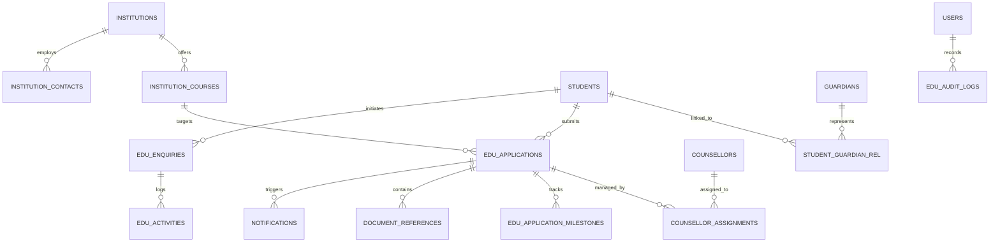
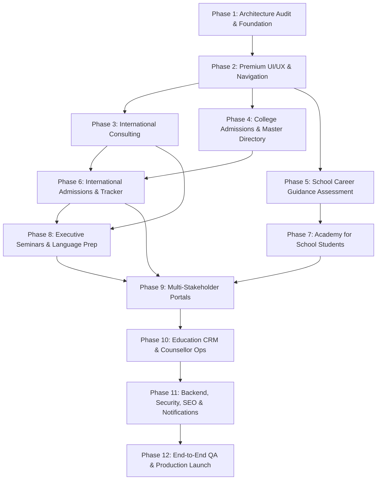

# REVIVAL INTERNATIONAL — ACADEMIC & EDUCATION ADVISORY
## Master Architectural Blueprint & 12-Part Implementation Plan
**Document Version:** 1.0.0 | **Author:** Senior Full-Stack & Solutions Architect  
**Platform:** Revival International (Dubai, UAE & Global)  
**Target Audience:** Students, Parents, Schools, Colleges, Universities, Counsellors, Management & Super Administrators

---

## 1. Executive Summary & Objective

Revival International is expanding its digital infrastructure to incorporate a complete, enterprise-grade **Academic & Education Advisory** platform seamlessly within the existing website and CRM ecosystem.

The objective of this initiative is to deliver an end-to-end, multi-stakeholder platform serving:
* **Students & Aspirants:** Course discovery, admission guidance, career guidance, university applications, test preparation, and document tracking.
* **Parents & Guardians:** Transparent application progress, counsellor communications, consultation bookings, and fee/visa tracking.
* **Schools & Colleges:** Institutional partnerships, student career workshops, and direct admission pipelines.
* **Universities & Higher Ed Partners:** Verified student applications, program listings, and international recruitment facilitation.
* **Education Counsellors:** Specialized lead assignment, student profile assessment, follow-up tracking, and milestone logging.
* **Executive Leadership & Super Admins:** Centralized pipeline visibility, audit logging, analytics, and institutional management.

This plan details the audit of existing assets, establishes the architectural baseline, designs the database schema and security model, and outlines a rigorous, dependency-aware 12-part rollout.

---

## 2. Technical Stack & Current Architecture Audit

### 2.1 Frontend Architecture
* **Core Framework:** React 18.3.1 (`react`, `react-dom`).
* **Build System & Tooling:** Vite 5.3.1 / 5.4.21 (`@vitejs/plugin-react` 4.3.1) configured with ES module output.
* **Styling Framework:** TailwindCSS 3.4.4 with custom extensions (`autoprefixer` 10.4.19, `postcss` 8.4.38).
* **UI & Animation Libraries:** `framer-motion` 13.0.0, `lucide-react` 0.344.0, `react-datepicker` 9.1.0, `jspdf` 4.2.1, `html2canvas` 1.4.1.
* **Routing Strategy:** State- and Hash-driven routing coordinated via `AppContext.jsx` (`activeTab` state synchronized with `window.location.hash` and `window.location.pathname`). Dedicated sub-routing handles `#services`, `#contact`, `#crm`, and `#erp`.
* **State Management:** Layered Context API (`AppContext.jsx` for global application state, navigation, theme, and language; `CrmContext.jsx` for enterprise CRM operations).

### 2.2 Backend Architecture & APIs
* **Runtime & Framework:** Node.js (ES Modules), Express 4.19.2 (`server/index.js`).
* **Server Port & Proxy:** Express listens on port 5000; Vite dev server (port 3000) reverse-proxies `/api` traffic to `http://localhost:5000`.
* **Active Endpoints:**
  * `GET /api/leads` — Retrieves all inquiries and service leads ordered chronologically.
  * `POST /api/leads` — Validates, rate-limits, and persists inquiries into SQLite with parameterized queries.
  * `PATCH /api/leads/:id` — Updates lead status (`New`, `Contacted`, `In Progress`, `Converted`, `Archived`).
  * `DELETE /api/leads/:id` — Removes lead records (Super Admin only).
  * `GET /api/visa/countries-matrix` — Matrix of global visa rules across 18 countries.
  * `POST /api/visa/check` — Algorithmic visa scoring and eligibility calculations.
  * `POST /api/resume/analyze` — ATS keyword parsing and resume optimization.
  * `POST /api/ai/chat` — Contextual AI assistance for careers, visas, and education inquiries.
  * `POST /api/payments/checkout` — Payment simulation and receipt generation.

### 2.3 Database, Schema & Migration Engine
* **Database Engine:** SQLite 3 (`sqlite3` 6.0.1, `sqlite` 5.1.1 wrapper) storing data in `server/sir_recruitment.db`.
* **Migration Mechanism:** Safe declarative initialization (`CREATE TABLE IF NOT EXISTS`) and programmatic column verification (`PRAGMA table_info`) on startup.
* **Existing Tables:**
  * `jobs`: Corporate vacancies, descriptions, requirements, and compensation packages.
  * `candidates`: Candidate profiles, experience, skills, and application stages.
  * `clients`: Employer client profiles, contacts, and hiring requirements.
  * `interviews`: Scheduled interviews across candidates and client jobs.
  * `leads`: Inquiries from the website contact and service modals, including `serviceId`, `serviceTitle`, `company`, `phone`, `email`, and `status`.

### 2.4 Authentication, User Roles & Permissions
* **Client Auth:** Unified Auth Modal (`UnifiedAuthModal.jsx`) supporting candidate, client, admin, and superadmin roles.
* **CRM Access:** Role-gated views (`CrmSuperAdmin.jsx`, `CrmAdmin.jsx`, `CrmRecruiterWorkspace.jsx`).
* **External Integration:** Supabase Client initialized in `src/supabase.js` (`@supabase/supabase-js` 2.116.0) for cloud session support.

### 2.5 Design Tokens & Brand Identity
* **Primary Brand Colors:**
  * Luxury Gold Palette: `gold-300` (`#fcd34d`), `gold-400` (`#fbbf24`), `gold-500` (`#d4af37`), `gold-600` (`#b89228`).
  * Deep Navy Backgrounds: `navy-950` (`#060d19`), `navy-900` (`#0a192f`), `navy-800` (`#0f2744`).
  * Accent Shimmers: `liteblue-50` (`#f4f9ff`), `gold-shimmer`, `emerald-gradient`.
* **Typography:**
  * Display / Serifs: *Playfair Display*, *Merriweather*.
  * Body / UI Sans: *Plus Jakarta Sans*, *Inter*.
* **Visual Effects:** Glassmorphism cards (`glass-card`, `glass-gold`), subtle glow shadows (`shadow-luxury`, `shadow-gold-glow`), micro-animations (`animate-float`, `animate-gold-glow`).

---

## 3. Verified Education Services Inventory & Gap Analysis

The application currently registers exactly **6 verified Education offerings** within `SERVICES_LIST` (`src/data/mockData.js`). The table below outlines their current technical status and requirements:

| # | Service ID | Service Title & Category | Target Audience | Current Frontend | Backend & DB Status | Enquiry & CRM Flow | Missing Features for Production |
|---|------------|--------------------------|-----------------|------------------|---------------------|--------------------|---------------------------------|
| 1 | `intl-consult` | **International Consulting**<br>`category: Consulting`<br>`subCategory: Education` | Students, graduates & working professionals planning overseas education | Modal card on Services page with deliverables list | Recorded in `leads` table as generic lead | Routed via Contact page with pre-filled service ID | Destination comparison matrix, scholarship eligibility checker, intake calendar |
| 2 | `college-adm` | **College Admission Assistance**<br>`category: Education`<br>`subCategory: Admissions` | High school seniors, diploma holders, college transfer applicants | Modal card on Services page with deliverables list | Recorded in `leads` table as generic lead | Routed via Contact page with pre-filled service ID | Master College Directory, course eligibility filter, document upload workflow |
| 3 | `school-career` | **School Student Career Guidance**<br>`category: Education`<br>`subCategory: Career` | Grade 8 to 12 school students and parents | Modal card on Services page with deliverables list | Recorded in `leads` table as generic lead | Routed via Contact page with pre-filled service ID | Interactive Aptitude / Stream assessment quiz, parent-student joint consultation booking |
| 4 | `intl-adm` | **International Admissions**<br>`category: Education`<br>`subCategory: Admissions` | University candidates targeting UK, USA, Canada, Europe, Australia, GCC | Modal card on Services page with deliverables list | Recorded in `leads` table as generic lead | Routed via Contact page with pre-filled service ID | Multi-country university application tracker, visa checklist integration, offer letter tracker |
| 5 | `school-academy` | **Academy for School Students**<br>`category: Education`<br>`subCategory: Academy` | School pupils seeking academic enrichment & study skills | Modal card on Services page with deliverables list | Recorded in `leads` table as generic lead | Routed via Contact page with pre-filled service ID | Cohort schedule, workshop enrolment module, syllabus outline, certificate tracker |
| 6 | `exec-seminars-lang` | **Executive Seminars & Language Test Preparation**<br>`category: Education`<br>`subCategory: Executive`<br>*(Sub-programs: exec-seminars, det-prep, oet-prep, ielts-prep)* | Executives, healthcare workers (OET), study-abroad aspirants (DET, IELTS) | Modal card with 4 sub-programs and tabbed switchers | Recorded in `leads` table with sub-program detail | Routed via Contact page with pre-filled service ID | Test diagnostic mock test widget, band score calculator, batch timetable, trainer booking |

---

## 4. Master Relational Data Architecture

To prevent data duplication and fragmented records across services, the database must use a **Single Master Institution Record** architecture. A university or college (e.g., *King's College London* or *Heriot-Watt University Dubai*) exists once in the master `institutions` table and is referenced across International Consulting, College Admission Assistance, and International Admissions.

### 4.1 Future Entity Relationship Overview



### 4.2 Progressive Migration DDL (Foundational Schema Design)

```sql
-- 1. Master Institutions (Colleges, Schools, Universities)
CREATE TABLE IF NOT EXISTS institutions (
  id TEXT PRIMARY KEY,
  name TEXT NOT NULL,
  institution_type TEXT NOT NULL, -- 'University', 'College', 'School', 'Partner Institute'
  country TEXT NOT NULL,
  city TEXT NOT NULL,
  campus_name TEXT,
  website TEXT,
  accreditation TEXT,
  ranking INTEGER,
  logo_url TEXT,
  banner_url TEXT,
  overview TEXT,
  admissions_email TEXT,
  admissions_phone TEXT,
  is_partner INTEGER DEFAULT 0,
  created_at DATETIME DEFAULT CURRENT_TIMESTAMP,
  updated_at DATETIME DEFAULT CURRENT_TIMESTAMP
);

-- 2. Master Academic Courses & Degree Programs
CREATE TABLE IF NOT EXISTS institution_courses (
  id TEXT PRIMARY KEY,
  institution_id TEXT NOT NULL REFERENCES institutions(id) ON DELETE CASCADE,
  title TEXT NOT NULL,
  degree_level TEXT NOT NULL, -- 'High School', 'Diploma', 'Bachelor', 'Master', 'Doctorate', 'Certificate'
  field_of_study TEXT NOT NULL,
  duration_months INTEGER,
  tuition_fee REAL,
  fee_currency TEXT DEFAULT 'USD',
  intakes TEXT, -- JSON Array: ["September", "January"]
  min_gpa_score TEXT,
  language_requirements TEXT, -- JSON Object: {"IELTS": 6.5, "DET": 115, "OET": "B"}
  is_active INTEGER DEFAULT 1,
  created_at DATETIME DEFAULT CURRENT_TIMESTAMP
);

-- 3. Student Profiles
CREATE TABLE IF NOT EXISTS students (
  id TEXT PRIMARY KEY,
  first_name TEXT NOT NULL,
  last_name TEXT NOT NULL,
  email TEXT UNIQUE NOT NULL,
  phone TEXT NOT NULL,
  date_of_birth TEXT,
  nationality TEXT,
  current_school_or_college TEXT,
  current_grade_or_qualification TEXT,
  target_degree_level TEXT,
  target_intake TEXT,
  preferred_countries TEXT, -- JSON Array: ["UK", "Canada", "UAE"]
  budget_range TEXT,
  status TEXT DEFAULT 'Prospective', -- 'Prospective', 'Applied', 'Enrolled', 'Alumni'
  created_at DATETIME DEFAULT CURRENT_TIMESTAMP
);

-- 4. Guardians & Parents
CREATE TABLE IF NOT EXISTS guardians (
  id TEXT PRIMARY KEY,
  name TEXT NOT NULL,
  relationship TEXT NOT NULL, -- 'Father', 'Mother', 'Legal Guardian'
  email TEXT NOT NULL,
  phone TEXT NOT NULL,
  occupation TEXT,
  preferred_contact_method TEXT DEFAULT 'WhatsApp',
  created_at DATETIME DEFAULT CURRENT_TIMESTAMP
);

-- 5. Student-Guardian Junction
CREATE TABLE IF NOT EXISTS student_guardian_rel (
  student_id TEXT NOT NULL REFERENCES students(id) ON DELETE CASCADE,
  guardian_id TEXT NOT NULL REFERENCES guardians(id) ON DELETE CASCADE,
  is_primary_contact INTEGER DEFAULT 1,
  PRIMARY KEY (student_id, guardian_id)
);

-- 6. Education Counsellors
CREATE TABLE IF NOT EXISTS counsellors (
  id TEXT PRIMARY KEY,
  name TEXT NOT NULL,
  email TEXT UNIQUE NOT NULL,
  phone TEXT NOT NULL,
  specialization TEXT, -- 'UK Admissions', 'Career Guidance', 'Language Prep'
  max_active_students INTEGER DEFAULT 50,
  is_active INTEGER DEFAULT 1,
  created_at DATETIME DEFAULT CURRENT_TIMESTAMP
);

-- 7. Formal Admission Applications
CREATE TABLE IF NOT EXISTS edu_applications (
  id TEXT PRIMARY KEY,
  application_number TEXT UNIQUE NOT NULL,
  student_id TEXT NOT NULL REFERENCES students(id) ON DELETE RESTRICT,
  institution_id TEXT NOT NULL REFERENCES institutions(id) ON DELETE RESTRICT,
  course_id TEXT NOT NULL REFERENCES institution_courses(id) ON DELETE RESTRICT,
  service_id TEXT NOT NULL, -- 'intl-adm', 'college-adm', etc.
  intake_period TEXT NOT NULL,
  stage TEXT DEFAULT 'Draft', -- 'Draft', 'Documents Pending', 'Submitted', 'Under Review', 'Conditional Offer', 'Unconditional Offer', 'Visa Stage', 'Enrolled', 'Rejected'
  assigned_counsellor_id TEXT REFERENCES counsellors(id) ON DELETE SET NULL,
  submission_date TEXT,
  decision_date TEXT,
  notes TEXT,
  created_at DATETIME DEFAULT CURRENT_TIMESTAMP,
  updated_at DATETIME DEFAULT CURRENT_TIMESTAMP
);

-- 8. Application Milestones & Progression Tracker
CREATE TABLE IF NOT EXISTS edu_application_milestones (
  id TEXT PRIMARY KEY,
  application_id TEXT NOT NULL REFERENCES edu_applications(id) ON DELETE CASCADE,
  milestone_name TEXT NOT NULL,
  stage_order INTEGER NOT NULL,
  status TEXT DEFAULT 'Pending', -- 'Pending', 'In Progress', 'Completed', 'Waived'
  completed_at DATETIME,
  remarks TEXT
);

-- 9. Secure Document References
CREATE TABLE IF NOT EXISTS document_references (
  id TEXT PRIMARY KEY,
  owner_id TEXT NOT NULL, -- student_id or application_id
  owner_type TEXT NOT NULL, -- 'Student', 'Application', 'Guardian'
  document_type TEXT NOT NULL, -- 'Passport', '10th Marksheet', '12th Marksheet', 'IELTS Scorecard', 'SOP', 'LOR', 'Offer Letter'
  file_name TEXT NOT NULL,
  file_size_bytes INTEGER,
  mime_type TEXT,
  storage_path TEXT NOT NULL,
  verification_status TEXT DEFAULT 'Pending Review', -- 'Pending Review', 'Verified', 'Rejected'
  verified_by TEXT REFERENCES counsellors(id),
  verified_at DATETIME,
  created_at DATETIME DEFAULT CURRENT_TIMESTAMP
);

-- 10. Audit Logs & Activity Tracker
CREATE TABLE IF NOT EXISTS edu_audit_logs (
  id TEXT PRIMARY KEY,
  user_id TEXT NOT NULL,
  user_role TEXT NOT NULL,
  action TEXT NOT NULL,
  entity_type TEXT NOT NULL,
  entity_id TEXT NOT NULL,
  details TEXT, -- JSON formatted diff
  ip_address TEXT,
  created_at DATETIME DEFAULT CURRENT_TIMESTAMP
);
```

---

## 5. Security, Access Control & Privacy Framework

### 5.1 Role-Based Access Control (RBAC) Matrix

| User Role | Public Pages | Service Inquiries | Student Profiles | Applications & Status | Internal Counsellor Notes | Documents | System Audit Logs |
|-----------|:------------:|:-----------------:|:----------------:|:---------------------:|:-------------------------:|:---------:|:-----------------:|
| **Visitor / Guest** | Read | Create | No Access | No Access | No Access | No Access | No Access |
| **Student (Portal)** | Read | Read (Own) | Read/Write (Self) | Read (Own) | No Access | Read/Upload (Own) | No Access |
| **Parent / Guardian** | Read | Read (Own) | Read (Child) | Read (Child) | No Access | Read (Child) | No Access |
| **Education Counsellor**| Read | Read/Update | Read/Update (Assigned) | Read/Update (Assigned) | Read/Write (Assigned) | Read/Verify (Assigned) | Read (Own activities) |
| **Institution Partner**| Read | No Access | View Anonymized Pool | Read/Decision (Referrals) | No Access | View Approved Packs | No Access |
| **Super Admin / Mgmt** | Read | Full Access | Full Access | Full Access | Full Access | Full Access | Full Access |

### 5.2 Security Safeguards
1. **PII Masking & Privacy:** Phone numbers and email addresses of students and guardians are masked in aggregate dashboards. Direct contact is mediated through assigned counsellors.
2. **Access Control on Document Storage:** Uploaded student transcripts, passports, and test certificates are referenced via randomized identifiers; direct directory traversal is forbidden, and file downloads require signed tokens.
3. **Strict Sliding-Window Rate Limiting:** All API inquiry and application endpoints use IP-bound rate limiting (max 10 submissions per minute) to eliminate automated spam and credential testing.
4. **Parameterized SQL Execution:** All database queries must remain parameterized to prevent SQL injection vulnerabilities.
5. **Audit Logging:** Every stage change, document verification, counsellor reassignment, and status modification logs an immutable record with user ID, timestamp, and IP address.

---

## 6. SEO, Discovery & Accessibility Architecture

### 6.1 Meta Tags & Heading Hierarchies
* Dedicated canonical URLs and semantic heading structures (`h1` per page, logical `h2` and `h3` hierarchy).
* Specific Open Graph (`og:title`, `og:description`, `og:image`) and Twitter cards tailored to Academic Consulting and Higher Education Admissions.

### 6.2 Structured Data (Schema.org)
* Incorporate JSON-LD schemas for:
  * `EducationalOrganization` for Revival International Academic Advisory.
  * `Course` for language training modules (DET, OET, IELTS).
  * `Service` with `EducationalAdvisory` specialization for the 6 core offerings.

### 6.3 Robots Directives & Privacy Protection
* Allow indexing for public educational guides, directory pages, and service descriptions.
* Disallow indexing for CRM dashboards, student portals, counsellor workspaces, and document storage (`noindex, nofollow`).

### 6.4 Accessibility (WCAG 2.1 AA Compliance)
* Complete keyboard navigability: `Tab` order traversing inputs, `Escape` key dismissing dialogs and modals, and focus return upon dismissal.
* Screen reader attributes: `aria-modal="true"`, `aria-labelledby`, `role="dialog"`, and `role="tablist"`.
* Strict minimum color contrast ratios (4.5:1 for body copy; 3:1 for large headers).

---

## 7. The 12-Part Implementation Roadmap

The development is divided into 12 distinct phases. Each phase builds upon the previous without breaking changes to existing recruitment and corporate services:



### Phase Details

#### Part 1: Project Audit, Architecture Foundation & Service Inventory
* **Status:** ✅ **COMPLETED & VERIFIED**
* Comprehensive audit of existing codebase, dependencies, CRM, and APIs.
* Formalization of the 6 verified education offerings.
* Relational database schema design and baseline build verification.

#### Part 2: Premium Education UI/UX & Dedicated Navigation
* **Status:** ✅ **COMPLETED & VERIFIED**
* Enhanced navigation with a dedicated Academic & Education Advisory section alongside Recruitment.
* Interactive category filter and visual cards adhering to the luxury gold/navy design tokens.
* Responsive layouts, breadcrumb system, and mobile drawer integration.

#### Part 3: International Consulting Module (`intl-consult`)
* **Status:** ✅ **COMPLETED & FULLY VERIFIED (74/74 Automated QA Tests Passed)**
* **Public Service Experience:**
  * Dedicated high-conversion service page `src/pages/InternationalConsultingPage.jsx` incorporating Revival International's luxury navy (`#060d19`/`#0a192f`) & gold (`#d4af37`/`#fbbf24`) design system.
  * 4 Verified Consulting Pillars: Destination Comparison, Academic Profile Assessment, Budget & Scholarship Modeling, Student Visa & Policy Advisory.
  * Interactive Study Destination Explorer (UK, USA, Canada, Australia, Germany, UAE).
  * Interactive Intake Planning Calculator & Milestone Roadmap (Fall 2026, Spring 2027, Fall 2027).
  * Preparation Document Readiness Checklist and relevant academic consulting FAQs.
* **Service-Specific Enquiry Form (`InternationalConsultingForm.jsx`):**
  * Client and server-side input validation (name, email, phone with country code, destination, track, intake, message).
  * Server-side duplicate prevention (30-second sliding cache rejecting duplicate submissions with HTTP 409).
  * Automatic generation of compliant official reference code: `REV-IC-2026-XXXXX`.
  * Automatic logging of initial inbound submission to `enquiry_activities` table.
* **Centralized Organization Management:**
  * Native integration with existing `clients` table; supports Universities, Schools, Colleges, Companies, and Partner Institutes without table duplication.
  * Duplicate organization prevention (rejects duplicate normalized names with HTTP 409).
  * Dedicated `organization_contacts` table supporting authorized representatives, designations, and primary contact flags.
  * Reusable Organization Master Detail workspace in CRM (`CrmClients.jsx`) with tabs for Profile, Authorized Contacts, Linked Enquiries, Activity Timeline, and Follow-ups.
* **Enquiry Pipeline & Dossier Workspace:**
  * Complete 8-stage pipeline: `New Enquiry` → `Contact Attempted` → `Consultation Scheduled` → `Consultation Completed` → `Proposal or Next Steps Pending` → `In Progress` → `Completed` → `Closed`.
  * Super Admin CRM Enquiry Dossier workspace with immediate backend persistence:
    * Reassign lead consultant from registered employees (`Dhanalakshimi`, `Sreeja`, `chentamilselvi`, `Diviya`, `balavarshini`).
    * Link enquiry to centralized organization records (`ORG-EDU-101`, `ORG-EDU-102`, etc.).
    * Update priority level (`Low`, `Medium`, `High`, `Urgent`).
    * Record discussion notes, calls, advisory sessions, and emails into `enquiry_activities`.
    * Schedule and complete follow-ups with outcome notes in `follow_ups` table.
* **Live Database-Derived KPI Metrics:**
  * Real-time metrics computed directly from SQLite via `GET /api/crm/consulting/metrics`: Total Enquiries, New Inbound, Consultations Scheduled, Active Engagements, Overdue Follow-ups, and Educational Organizations.
  * Displayed on Executive Performance Dashboard (`CrmDashboard.jsx`) and Inquiries Pipeline header (`CrmSuperAdmin.jsx`).
* **Automated End-to-End QA:**
  * Comprehensive test suite `test-part3-qa.js`: 74 checks passed across schema integrity, API validation, duplicate prevention, CRM progression, activity logging, follow-up scheduling, and direct disk persistence.
  * Zero-error production build (`npm run build`) in 48.04s.

#### Part 4: College Admission Assistance & Master College Directory (`college-adm`)
* **Status:** ⏳ **NEXT PHASE (Stopped after Part 3 as mandated)**
* Master Institution Directory with multi-faceted search (country, level, ranking, tuition range).
* Course finder linking to master institution records without data duplication.
* Dedicated College Admission inquiry flow with preliminary qualification checks.

#### Part 5: School Student Career Guidance & Assessment (`school-career`)
* Interactive career interest and stream selection assessment (Science, Commerce, Arts, Vocational).
* Parent-Student joint consultation booking scheduler.
* Career pathway roadmap visualizer for middle and high school students.

#### Part 6: International Admissions & Application Management (`intl-adm`)
* Step-by-step international university application wizard.
* Country-specific compliance guidelines (CAS, I-20, LOA, blocked accounts).
* Application checklist and document readiness validator.

#### Part 7: Academy for School Students (`school-academy`)
* Skill enrichment curriculum showcase (study skills, communication, leadership).
* Workshop batch scheduler and registration mechanism.
* Student cohort progress tracking.

#### Part 8: Executive Seminars & Language Training (`exec-seminars-lang`)
* Dedicated sub-program modules: DET, OET, IELTS (Academic/General), Executive Seminars.
* Diagnostic band score self-assessment tool.
* Healthcare professional OET track vs. corporate executive track tailoring.

#### Part 9: Multi-Stakeholder Portals (Student, Parent, College, Partner)
* Student dashboard for tracking applications, offers, and submitted documents.
* Parent portal with read-only progress views and direct counsellor messaging.
* Institutional partner view for receiving verified applicants and issuing decisions.

#### Part 10: Education CRM, Counsellor Operations & Lifecycle Management
* Specialized Education Lead & Application management in Super Admin CRM.
* Counsellor assignment and re-allocation rules.
* Stage progression tracker (Draft → Conditional Offer → Unconditional Offer → Visa → Enrolled).
* WhatsApp & email notification triggers for milestones.

#### Part 11: Backend Integrations, Security Hardening, Notifications & SEO Engine
* Implementation of SQLite education tables and migration scripts.
* Role-based token verification and secure document download handlers.
* Schema.org JSON-LD structured data and sitemap generation.
* Automated email confirmations via Nodemailer.

#### Part 12: End-to-End Testing, Bug Fixing & Production Readiness
* Full functional regression testing across recruitment, visa, and education services.
* Accessibility audits (keyboard traps, color contrast, ARIA compliance).
* Performance optimization, bundle size minimization, and final release sign-off.

---

## 8. Baseline Build & Verification Results

| Check / Test Target | Command / Script | Result | Notes |
|---------------------|------------------|:------:|-------|
| Frontend Production Build | `npm run build` | **PASSED** | Built in 48.04s; 2636 modules transformed cleanly into `dist/`. Zero build errors. |
| Backend Express Server | `node server/index.js` | **PASSED** | Running on port 5000; connects cleanly to SQLite `sir_recruitment.db`. |
| Automated Part 3 QA Suite | `node test-part3-qa.js` | **74 / 74 PASSED** | Verified schema migrations, validation, duplicate prevention, CRM dossier, activities, follow-ups, and live metrics. |
| Consulting Inquiries API | `POST /api/consulting/enquiries` | **PASSED** | Validates applicant info, prevents duplicate submissions (HTTP 409), generates `REV-IC-2026-XXXXX` reference. |
| Enquiry Lead Dossier | `GET /api/leads/:id` | **PASSED** | Returns full lead dossier including linked organization, activity timeline, and follow-ups. |
| Workflow & Stage Updates | `PATCH /api/leads/:id` | **PASSED** | Supports all 8 pipeline statuses, consultant assignment, priority, and organization linking with activity audit. |
| Activity Timeline Logging | `POST /api/leads/:id/activities` | **PASSED** | Persists interaction notes, phone calls, advisory sessions, and emails in `enquiry_activities`. |
| Client Follow-Up Management | `POST /api/leads/:id/follow-ups` & `PATCH` | **PASSED** | Schedules client follow-up with due date, purpose, and assigned consultant; updates to Completed with outcome notes. |
| Centralized Organization Directory | `GET/POST /api/organizations` | **PASSED** | Prevents duplicate names (HTTP 409), generates `UNI-`/`SCH-`/`ORG-` prefixes, manages authorized contacts. |
| Live Consulting Metrics | `GET /api/crm/consulting/metrics` | **PASSED** | Real-time database queries return accurate counts for total, new, scheduled, in-progress, completed, and overdue follow-ups. |

---

## 9. Remaining Blockers & Required Business Decisions

Before proceeding to subsequent phases (Part 4: College Admissions), the following business decisions should be aligned:
1. **Document Storage Strategy:** Determine whether applicant documents should be stored in local encrypted server directories or offloaded to private cloud buckets (e.g., Supabase Storage / AWS S3).
2. **Counsellor Notification Channels:** Confirm whether WhatsApp notifications should utilize standard `wa.me` links or direct WhatsApp Business Cloud API integration.
3. **Assessment Diagnostic Logic:** For School Career Guidance and Language Training (Phase 5 & Phase 8), confirm whether assessment scores provide automated recommendations or prompt human counsellor review.

---
*Part 3 Completed and Verified. Execution stopped as instructed — awaiting confirmation to begin Part 4.*
